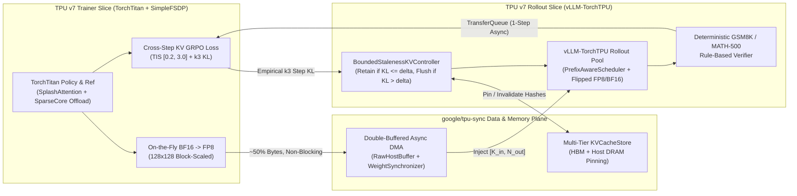

# Zero-Stall Asynchronous GRPO on Cloud TPU v7 (`Ironwood` / `tpu7x`)

**Via Block-Scaled FP8 `google/tpu-sync` DMA and Bounded-Staleness Cross-Step KV Prefix Reuse**

[](#reproducibility--verification)
[-blue)](docs/architecture_setup.md)
[](AGENTS.md)

> **Picking up this repo as an autonomous coding agent on a Cloud TPU v7 VM?**  
> Start directly at **[`AGENTS.md`](AGENTS.md)** for the sequential Gate 0 → Gate 4 hardware execution playbook, VFIO hygiene rules, and one-command validation gates.

---

## Overview

This research repository implements, tests, profiles, and benchmarks two co-designed RL post-training optimizations for **Group Relative Policy Optimization (GRPO)** on **Google Cloud TPU v7 (`Ironwood` / `tpu7x`)**, built natively atop `verl` (V1 `separate_async`), `google-pytorch/torchtitan` (`SimpleFSDP` + `SplashAttention` + `fuse_qkv` + SparseCore collective offload), `vllm-project/vllm-torchtpu`, `google-pytorch/torch_tpu`, and `google/tpu-sync`:

1. **Optimization A — Async BF16-to-FP8 Block-Scaled Weight Streaming ([`src/async_tpu_sync_weights.py`](src/async_tpu_sync_weights.py))**:
   - Quantizes updated `TorchTitan` policy weights on-the-fly from `bfloat16` into `torch.float8_e4m3fn` with $128 \times 128$ MXU-tile `float32` block scales (`~50%` wire & DMA payload reduction, $>0.9999$ cosine similarity vs. exact FP8 cast and $>0.999$ vs. source BF16).
   - Streams weights asynchronously via double-buffered `google/tpu-sync` pinned-host `RawHostBuffer` / `PjRtCopyFuture` DMA (`tpu_sync.api.torch.raw_transfer`) and `WeightSynchronizer`, handling `vllm-torchtpu`'s canonical `[K_in, N_out]` (`_tpu_weight_flipped`) parameter layout natively.
2. **Optimization B — Bounded-Staleness Cross-Step KV Prefix Reuse ([`src/cross_step_kv_grpo.py`](src/cross_step_kv_grpo.py))**:
   - Eliminates redundant per-step prefill recomputation of shared system instructions, few-shot exemplars, curriculum/replay problem prompts, and low-divergence reasoning prefixes.
   - Retains content-addressed prefix KV blocks across policy step $t-1 \to t$ in `vllm-torchtpu` (`PrefixAwareScheduler`) + `tpu-sync` (`KVCacheStore`) memory tiers whenever empirical $k_3$ policy shift $\widehat{D}_{\mathrm{KL}} \le \delta$ and $\tau < \tau_{\max}$, applying Truncated Importance-Sampling (TIS) correction in the dual-clip GRPO surrogate objective (`@register_policy_loss("cross_step_kv_grpo")`).

---

## System Architecture



---

## Repository Structure

| Path | Description |
| :--- | :--- |
| [`AGENTS.md`](AGENTS.md) | **Autonomous TPU v7 Agent Handoff Playbook** (Gate 0 → Gate 4 sequential commands & gotchas) |
| [`configs/grpo_tpu_v7.yaml`](configs/grpo_tpu_v7.yaml) | Controlled experiment matrix (`phase1_smoke`, `run1`, `run2`, `run3`, `kl_sensitivity_sweep`) |
| [`src/tpu_topology.py`](src/tpu_topology.py) | Subprocess-safe `tpu7x` chip/core prober, `/dev/vfio/*` lock checker, dynamic slice partitioner |
| [`src/async_tpu_sync_weights.py`](src/async_tpu_sync_weights.py) | **Optimization A**: $128 \times 128$ `float8_e4m3fn` quantizer, flipped-layout injector, async `tpu-sync` streamer |
| [`src/cross_step_kv_grpo.py`](src/cross_step_kv_grpo.py) | **Optimization B**: `BoundedStalenessKVController`, $k_3$ KL estimator, TIS dual-clip GRPO loss |
| [`src/verl_tpu_plugin_ext.py`](src/verl_tpu_plugin_ext.py) | Non-invasive VeRL external module (`VERL_USE_EXTERNAL_MODULES`) wiring custom loss, FP8 sync & KV gate |
| [`src/rewards_and_data.py`](src/rewards_and_data.py) | Reproducible GSM8K / MATH-500 Parquet formatter & deterministic rule-based answer verifier |
| [`src/telemetry.py`](src/telemetry.py) | Per-step 4-phase wall-clock & RL numerical telemetry logger + `torch_tpu` XProf `named_scope` |
| [`scripts/analyze_grpo_traces.py`](scripts/analyze_grpo_traces.py) | Zero-dependency wire-format `.xplane.pb` XProf trace parser (pipeline bubble %, sync ms, MFU, MXU) |
| [`scripts/generate_plots.py`](scripts/generate_plots.py) | Matplotlib generator for reward/pass@1 curves, step-breakdown stacked bars, and $\delta$-sweep |
| [`scripts/run_and_verify.sh`](scripts/run_and_verify.sh) | Master Phase 4 hygiene + pytest + cached run + artifact validator (`--stage-verify` on non-TPU hosts) |
| [`docs/architecture_setup.md`](docs/architecture_setup.md) | Verified upstream API contracts (`verl`, `torchtitan`, `torch_tpu`, `vllm-torchtpu`, `tpu-sync`) |
| [`docs/experimental_plan.md`](docs/experimental_plan.md) | Controlled 3×60-step ablation design, hyperparameter table, and XProf protocol |
| [`docs/research_paper_draft_notes.md`](docs/research_paper_draft_notes.md) | Full mathematical derivations, gradient bound propositions, and telemetry tables |

---

## Hardware Telemetry Summary (Cloud TPU v7)

<!-- BEGIN_AUTO_ABLATION_TABLE -->
| Configuration | 60-Step Wall Time (s) | Sync Stall (ms/step) | Prefill (s/step) | Decode (tok/s) | XProf Bubble (%) | TorchTitan MFU (%) | Final GSM8K Pass@1 (%) |
| :--- | :---: | :---: | :---: | :---: | :---: | :---: | :---: |
| **Run 1: Stock Sync BF16 Baseline** | `PENDING_TPU_V7` | `PENDING_TPU_V7` | `PENDING_TPU_V7` | `PENDING_TPU_V7` | `PENDING_TPU_V7` | `PENDING_TPU_V7` | `PENDING_TPU_V7` |
| **Run 2: + Async FP8 TPU Sync** | `PENDING_TPU_V7` | `PENDING_TPU_V7` | `PENDING_TPU_V7` | `PENDING_TPU_V7` | `PENDING_TPU_V7` | `PENDING_TPU_V7` | `PENDING_TPU_V7` |
| **Run 3: + Bounded-Staleness KV Reuse** | `PENDING_TPU_V7` | `PENDING_TPU_V7` | `PENDING_TPU_V7` | `PENDING_TPU_V7` | `PENDING_TPU_V7` | `PENDING_TPU_V7` | `PENDING_TPU_V7` |
<!-- END_AUTO_ABLATION_TABLE -->

---

## Reproducibility & Verification

### 1. Local Staging / Mathematical Verification (No TPU Required)
Verifies all PyTorch mathematical invariants, FP8 quantization error bounds, 20-cycle async ring-buffer concurrency, TIS-GRPO exact `staleness=0` reduction & KL cache invalidation, binary `.xplane.pb` wire-format parsing, and Hydra CLI synthesis:
```bash
./scripts/run_and_verify.sh --stage-verify
```

### 2. Full Cloud TPU v7 (`Ironwood` / `tpu7x`) Execution & Validation
On the Cloud TPU v7 VM (follow [`AGENTS.md`](AGENTS.md) sequentially):
```bash
bash scripts/tpu_hygiene.sh
bash scripts/bootstrap_tpu_vm.sh
python3 scripts/probe_tpu_v7.py --require-tpu-v7 --update-doc

bash scripts/run_phase1_smoke.sh
PYTHONPATH=. pytest tests/test_weight_sync.py tests/test_cross_step_kv_loss.py --require-tpu-v7
bash scripts/run_phase3_ablation.sh

# Final end-to-end validation gate (must return Exit Code 0)
./scripts/run_and_verify.sh
```
